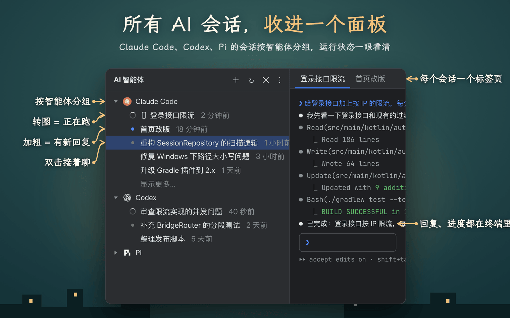
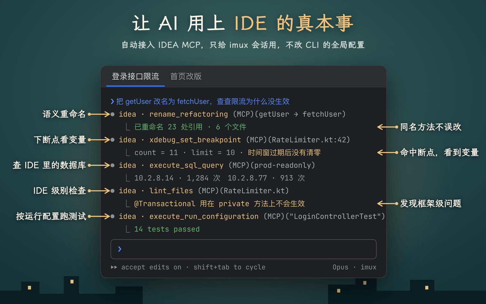
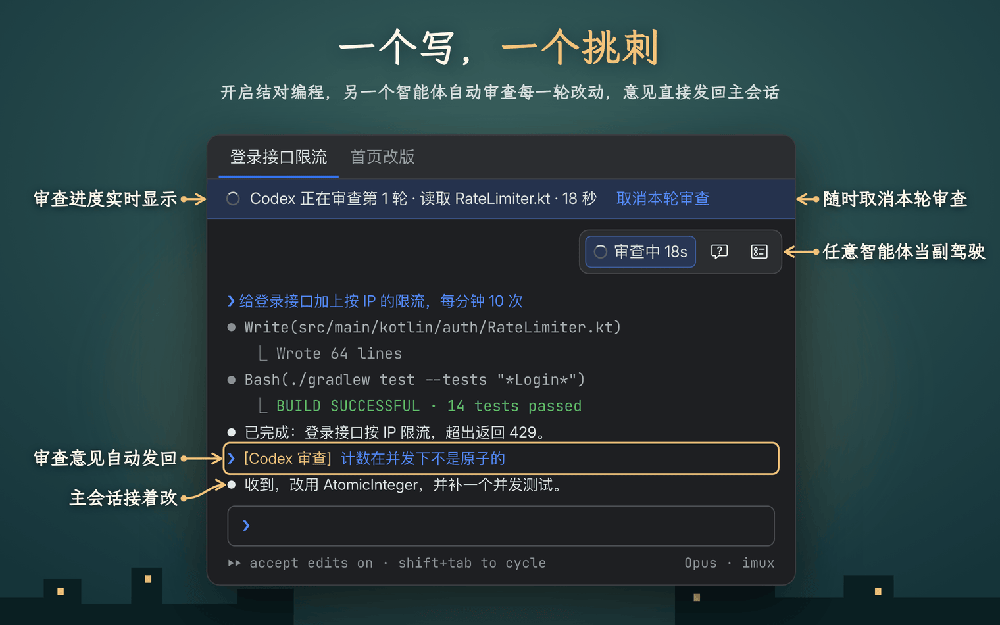
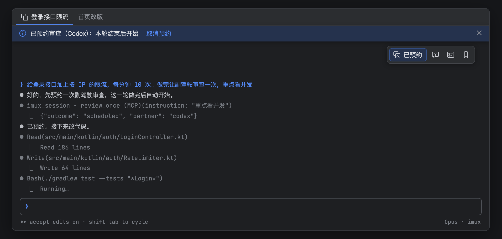
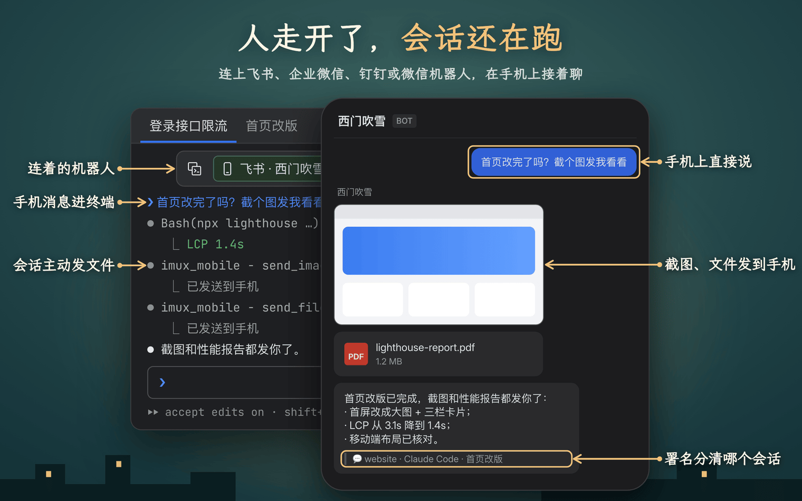
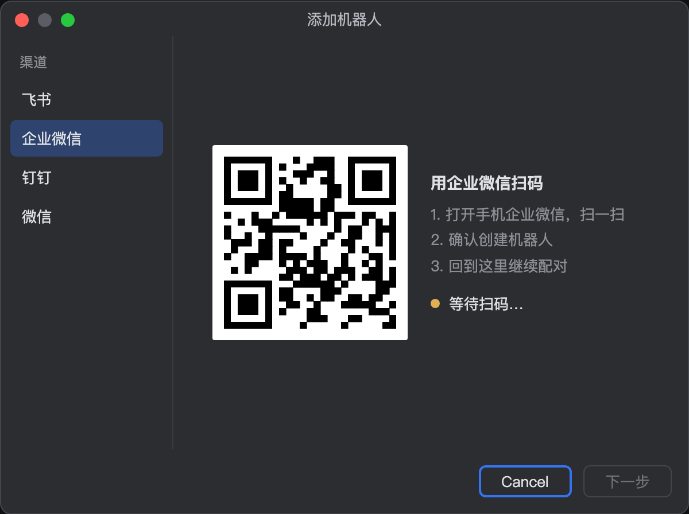
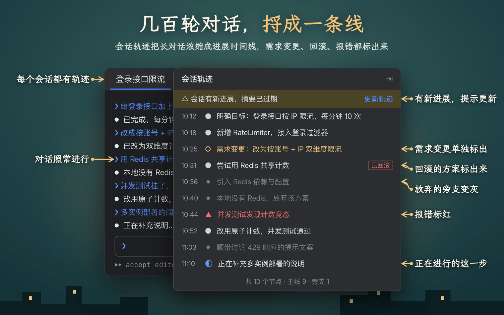
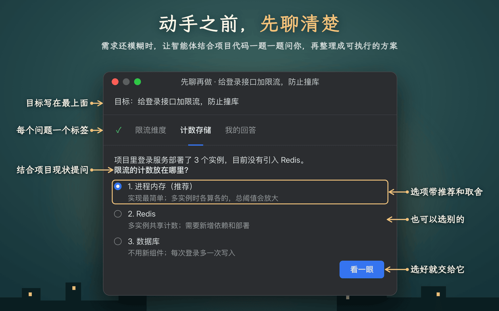
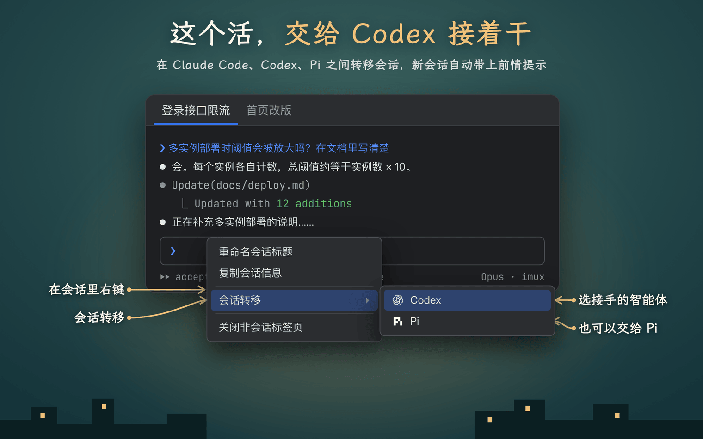

# imux

**把 JetBrains IDE 变成 AI 编程驾驶舱**：在编辑器标签页里运行 Claude Code、Codex 和 Pi 会话，让它们用上 IDE 的调试器、重构、检查和数据库连接，还能让另一个 AI 帮你审查，或者在手机上接着聊。

- **AI 用上 IDE 的能力**：自动接入 JetBrains MCP，语义重命名、调试、inspections、运行配置都能用
- **会话一目了然**：侧栏按智能体分组，运行中、未读、跑完提醒都看得到
- **结对编程**：另一个 AI 自动审查每一轮，或者只审一次
- **手机桥接**：用飞书、企业微信、钉钉或微信继续对话，截图和文件也能发到手机
- **会话轨迹**：把几百轮对话浓缩成一条进展时间线
- **先聊再做**：动手前先把需求聊清楚
- **会话转移**：把手上的活交给另一个智能体接着干

https://github.com/user-attachments/assets/c6b6c55b-b073-4255-a722-fa830e134028

## 安装与上手

需要 **JetBrains IDE 2026.2+**，并至少装好 `claude`、`codex`、`pi` 其中一个（在你的终端里能直接运行即可）。

1. **Settings → Plugins → Marketplace** 搜索 **imux**，安装后重启。
2. 打开左侧的 **AI 智能体** 面板，点 **+** 选一个智能体，会话就在编辑器标签页里跑起来。
3. 双击列表里的旧会话可以接着聊。

## 会话面板

会话按智能体分组、最近的在上面。转圈表示正在跑，圆点加粗表示有新结果没看，灰点表示已在标签页里开着。

一轮跑完时右下角会弹提醒，IDE 不在前台时还会发系统通知；窗口标题也会显示「1 个未读 · 2 个运行中」。

## AI 用上 IDE 的能力

imux 启动的会话会自动接入 JetBrains MCP，AI 可以用 IDE 的语义重命名、调试器、inspections、运行配置、已保存的数据库连接和项目 Code Style，而不是全局文本替换、加 print 调试。

只对 imux 启动的会话生效，不改 CLI 的全局配置。可在 **Settings → Tools → Imux → IDEA MCP** 关闭或调整。

## 结对编程

点会话右上角图标组里的 **结对编程** 按钮，选一个副驾驶（比如 Claude Code 写、Codex 审）。主会话每完成一轮，副驾驶自动审查并把意见发回来；只想审一次就在同一个菜单里选 **审查一次**。

也可以直接在任务里说：

「做完让副驾驶审查一次」会在这一轮结束后审一次，预约期间可以取消；「开启结对编程」「关闭结对编程」同理。

## 手机桥接

1. **Settings → Tools → Imux → 通讯机器人** 添加机器人，用手机扫码。
2. 在会话右上角点 **手机** 按钮，选这个机器人。

之后手机上发的消息直接进终端，每轮的结论推回手机。会话停下来要你确认权限或做选择时，手机会收到排成列表的选项，只回编号或字母（如「2」「b」）即可选择；也可以直接说你的要求：有自定义输入项就填进去提交，没有就拒绝这个选择、把这句话交给会话。插件发到手机的每条消息末尾都注明是哪个工程、哪个智能体的哪个会话。说「把截图发我手机」，会话就会把图片、视频或文件发过来。

## 会话轨迹

点会话右上角的轨迹图标，imux 让智能体读完整段会话，浓缩成一条时间线：主线进展、需求变更、报错、回滚过的尝试都单独标出来。会话有新进展后点「更新轨迹」，只读新增的部分。

## 先聊再做

需求还模糊时，点右上角图标组里的 **先聊再做** 按钮。Agent 结合项目代码一批批地问你关键问题，每题给出带推荐的选项；聊完整理成方案，点 **发给 Agent** 就在这个终端开始执行。

## 会话转移

在会话终端里右键 → **会话转移**，选 Codex 或 Pi：新开一个标签页，自动填入一段提示词，帮新会话接上之前的工作。Claude Code、Codex、Pi 之间都能互相转移。

## 直接对会话说

不用点菜单，在对话或任务里（包括从手机发的）直接说就行：

| 你可以说 | 会话会做什么 |
| --- | --- |
| 「开启结对编程」/「用 codex 结对」 | 开启或更换副驾驶 |
| 「关闭结对编程」 | 停止结对，取消还没开始的预约 |
| 「做完让副驾驶审查一次」 | 这一轮结束后审查一次 |
| 「把截图发我手机」/「把这个文件发给我」 | 发图片、视频、文件到手机 |

只对新打开的会话生效；不想每次确认，可以把 `mcp__imux_session__*`、`mcp__imux_mobile__*` 加进 CLI 的权限白名单。

## 还要知道的

- **关闭标签页会结束会话进程**，但对话记录还在，双击面板里的会话即可恢复。重开项目时之前的标签页会自动恢复。
- **不托管你的会话**：只读各 CLI 自己的会话库，不改对话文件；删掉插件，记录一条不少。
- 设置都在 **Settings → Tools → Imux**。

更完整的说明（各项设置、注入方式、审查轮次规则、轨迹缓存、读取了哪些文件、已知限制）见 [详细说明](docs/guide.md)。

## 许可证

[Apache License 2.0](LICENSE)
