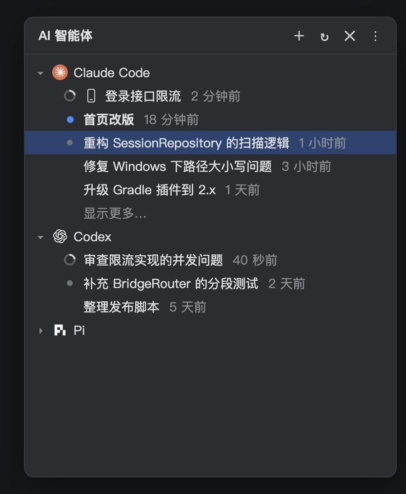
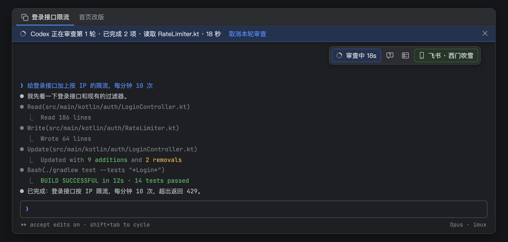
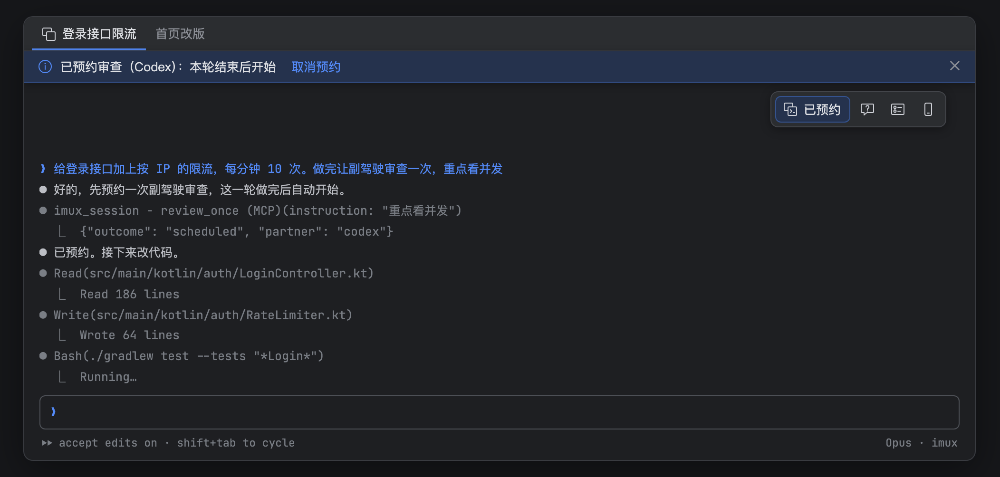
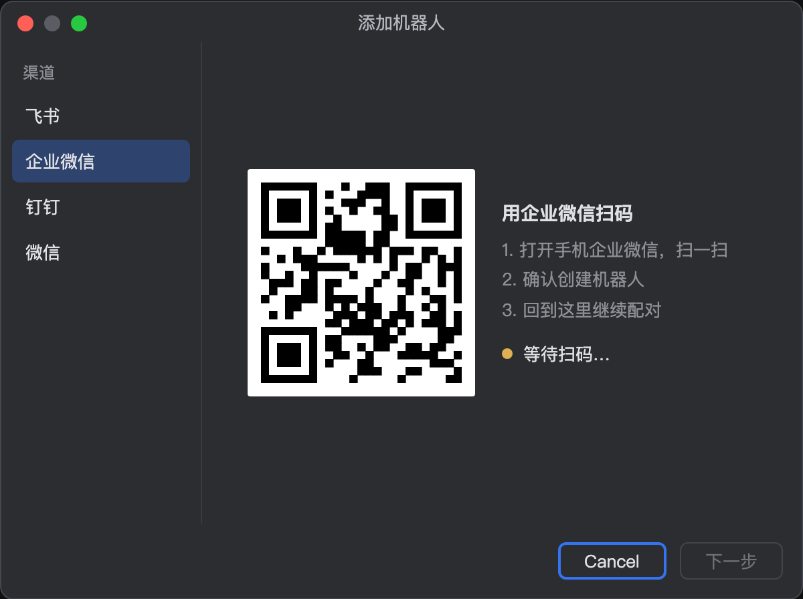
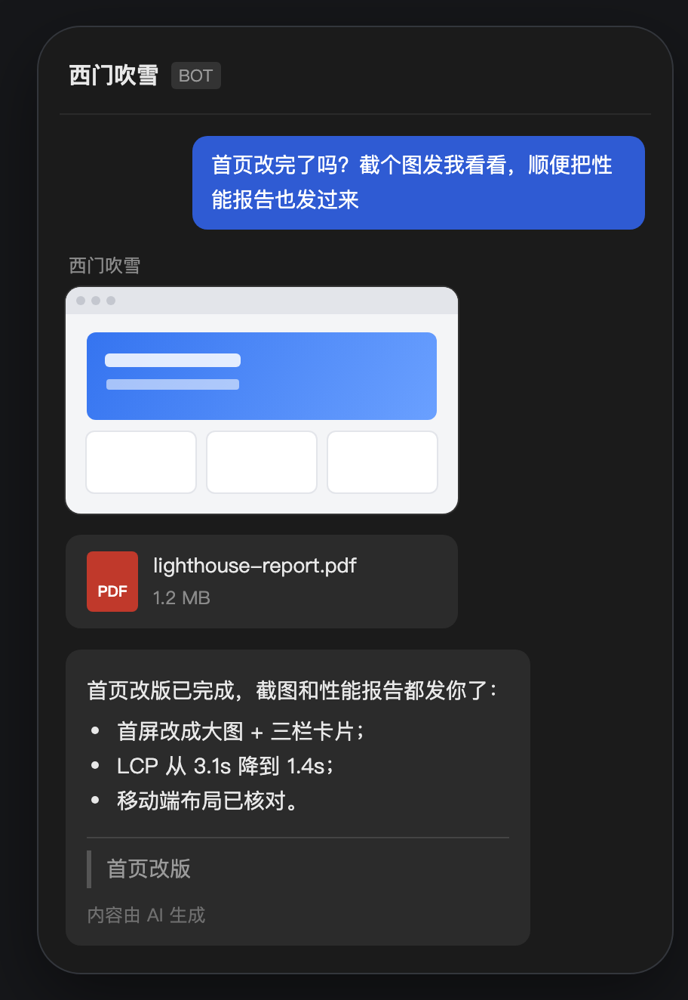
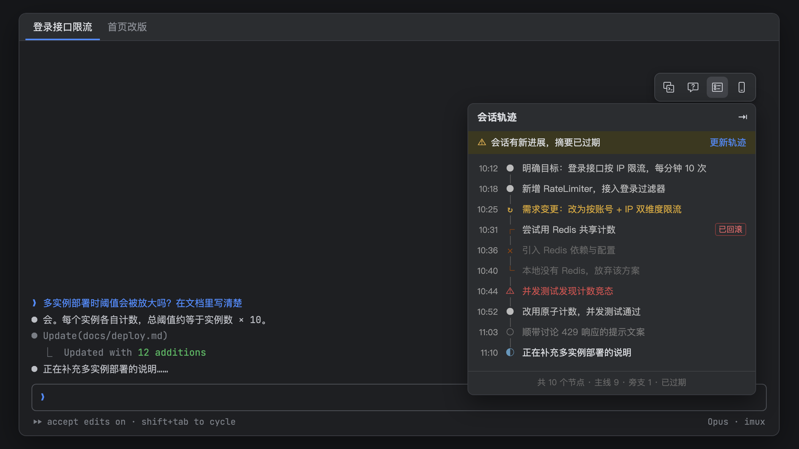
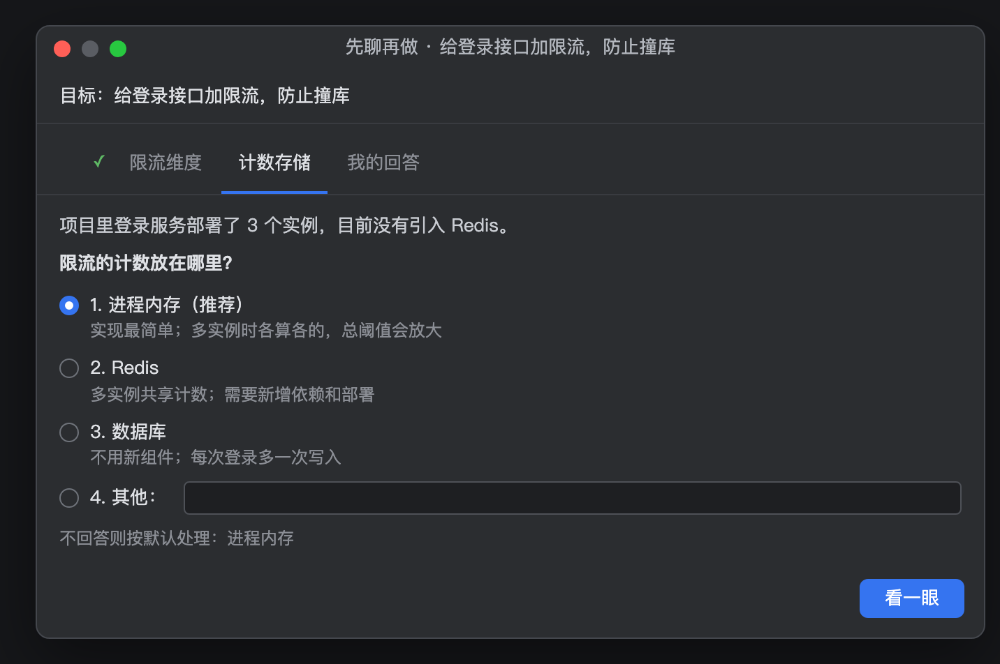

# imux 详细说明

这里是各功能的完整说明和实现细节；快速了解请看 [README](../README.md)。

## 为什么用 imux，而不是在终端里直接跑 AI？

AI 编程智能体很强，但它们原生的工作方式更像一个**只有文本编辑器和终端的程序员**——能读文件、写文件、跑命令，却用不了 IDE 里那些真正提升代码质量的功能。

imux 解决这个问题：

以下是 imux 注入 IDEA MCP 后**可能**带来的改变（具体取决于你的 IDE 产品、已安装插件和 MCP 端口是否可达）：

| 没有 imux | 有 imux + 注入设置开启 + MCP 可达 + IDE 提供该工具（Pi 还需扩展脚本及原生 MCP 注册能力） |
| --- | --- |
| 重命名变量 → 文本全局替换，容易误改 | AI 可以用 IDE 的语义重命名 |
| 排查 bug → 加 print 语句，一轮轮试 | AI 可以用 IDE 的调试器 |
| 检查代码 → 只有编译器和 linter | AI 可以用 IDE 的 inspections |
| 跑测试 → 手拼命令，经常漏参数 | AI 可以复用 IDE 的运行配置 |
| 查数据库 → 自己配连接和凭据 | AI 可以复用 IDE 已保存的数据库连接 |
| 格式化 → 外部 formatter，规则可能不一致 | AI 可以用项目配置的 Code Style |

这一切通过 **IDEA MCP 自动注入**实现——imux 会把 JetBrains MCP 服务器作为会话级配置注入它启动的 AI 会话（需在设置中开启，默认开启），不修改任何 CLI 的全局配置。

**适用于所有 JetBrains IDE**（IntelliJ IDEA、PyCharm、WebStorm、GoLand、Rider、CLion 等）和所有它们支持的语言。各 IDE 通过 MCP 暴露的工具集可能不同——例如数据库工具仅在支持 Database 功能的产品中可用。

## 开始之前

- **JetBrains IDE 2026.2 或更新版本**（最低 Platform build 262，不设上限；后续版本如有 API 不兼容将通过新版修复）
- **`claude` / `codex` / `pi` 至少装好一个**，且在你的终端里直接敲命令能跑通

imux 不负责安装这些 CLI，也不管它们的登录和配置。你在系统终端里能用，在 imux 里就能用——它是用你的登录 shell（`$SHELL`，取不到则用 `/bin/zsh`）启动它们的，所以你的 PATH、alias、环境变量都在。

**用 Claude 的请留意 `--settings`**：imux 启动 Claude 时会用 `--settings` 为这次会话注入 hook（用于在手机上确认，见「手机桥接」），不改任何配置文件，与 `settings.json` 里的设置照常合并。但命令行上的多个 `--settings` 不合并，后一个整体覆盖前一个：如果你的 alias 里自带 `--settings`，那一份在 imux 启动的会话里不生效，需要的设置请挪到 `settings.json`。

装一个也能用，面板里其余分组空着就是了。

## 安装

IDE 里 **Settings → Plugins → Marketplace**，搜索 **imux**，Install，重启。

## 快速上手

1. 打开左侧边栏的 **AI Agents** 面板。
2. 点面板右上角 **+**，选 Claude Code、Codex 或 Pi，新建一个会话。
3. 会话在编辑器标签页里跑起来，和你的代码文件并排——可以分屏，可以拖到另一个窗口。

想接着之前的聊？**双击**列表里的任意会话，imux 会用 `claude --resume` / `codex resume` / `pi --session-id` 把它捞回来。

## IDEA MCP：让 AI 用上 IDE 的能力

这是 imux 最核心的功能。

当"注入 IDEA MCP"设置开启时（默认开启），imux 会把 JetBrains MCP 服务器的连接配置注入 CLI 启动参数。AI 通过 MCP 协议的 `tools/list` 动态发现可用工具——实际清单取决于你的 IDE 产品、已安装插件和 MCP 服务版本。以 IntelliJ IDEA Ultimate 2026.2 为例，典型工具覆盖：

| 能力 | AI 能做什么 |
| --- | --- |
| **调试器** | 设断点、单步执行、查看变量、求值表达式、修改运行时状态 |
| **数据库** | 用 IDE 保存的连接查询数据库、浏览表结构 |
| **重构与编辑器** | 语义安全重命名、按项目 Code Style 格式化 |
| **检查与项目模型** | 框架级 inspections、已解析的模块和依赖图 |
| **PSI 自定义检查** | 编写并运行自定义 Kotlin 检查脚本 |
| **语义导航** | 调用层级分析、符号搜索、类型和文档查看 |
| **运行配置** | 用 IDE 保存的配置运行和测试 |
| **Python 环境** | 获取和配置 IDE 管理的解释器 |
| **文件与搜索** | 读依赖库源码/反编译、项目内搜索 |
| **其他** | 构建、终端、VCS、动态工具 |

### 三种注入方式

| 智能体 | 注入方式 | 注入的配置 |
| --- | --- | --- |
| Claude Code | `--mcp-config` 传入 | MCP 服务器连接信息 |
| Codex | `-c mcp_servers.idea.url=...` | MCP 服务器 URL 和请求头 |
| Pi | 加载 `pi-imux-idea-mcp.js` | 通过原生 `registerMcpServer` 注册 `idea`，按需加载完整工具 schema；旧版不支持时跳过 |

注入是会话级的，**不修改 `~/.claude.json`、`~/.codex/config.toml` 或 pi 的全局设置**。

注入 ≠ 可用。imux 只负责向 CLI 提供 MCP 连接配置——即使端口暂时不可达，配置仍会注入，工具能否实际调用取决于 MCP 服务器在会话期间是否可达。端口不可达时会弹出提示，但该提示按项目级探测状态去重：同一端口连续不可达只提示一次；恢复后再次不可达、或切换到其他端口再切回时，都会重新提示。项目已关闭时不提示。Pi 通过插件自带的扩展脚本（`pi-imux-idea-mcp.js`）注册原生 MCP 服务；如果脚本缺失或 Pi 不支持 `registerMcpServer`，直接跳过 IDEA MCP 及其引导词注入，不使用自定义桥接回退。支持时可在 Pi 的 `/mcp` 中查看服务，通过 `tool_search` 按需加载工具。关闭"注入 IDEA MCP"设置后，会话不注入任何 MCP 配置。

结对编程的副驾驶遵循同样的规则：设置开启时注入，关闭时不注入；端口不可达时配置仍注入但工具可能不可用；Pi 副驾驶在扩展脚本缺失或不支持原生 MCP 注册时跳过注入。副驾驶进程是一次性的——CLI 非零退出时，imux 通常会弹出错误通知，但项目已关闭时会跳过。取消和解绑在 CLI 返回前生效时会跳过后续处理，但由于检查和通知分别在 IO 线程和 EDT 上执行，极端时序下取消或解绑后仍可能弹出错误通知（该通知与正常错误通知相同，不会被代码自动清除）。CLI 正常退出但未产生有效反馈时静默跳过，不通知。imux 不保证降级条件下 CLI 进程一定能正常完成。

### 智能引导

imux 可以注入一段提示词引导，告诉 AI 在什么场景该用哪个 IDEA MCP 工具、什么场景继续用原生工具。引导词在 **Settings → Tools → Imux → IDEA MCP** 中可查看、编辑和恢复默认。

## 面板里都有什么

会话按 **Claude Code**、**Codex**、**Pi** 分成三组，组内按最后活动时间倒序，最近用的在最上面。每组先显示 10 条，更早的点底部 **显示更多…** 展开。



每行是：**状态图标 + 会话标题 + 相对时间**。标题由 CLI 自己生成，没有的话回退成你的第一句话。

状态图标：

| 图标 | 含义 |
| --- | --- |
| 转圈动画 | 正在跑 |
| 圆点 + 标题加粗 | 有新结果你还没看 |
| ● 灰点 | 已经在某个标签页里开着 |
| 无 | 空闲 |
| 手机图标（跟在状态图标后） | 这个会话连着手机 |

## 跑完了会提醒你

一轮对话完成时，右下角弹出气泡：

```
Codex · 耗时 2 分 13 秒
重构 SessionRepository 的扫描逻辑
```

点气泡上的 **打开会话**，直接跳到那个标签页并滚到最新输出。

**IDE 窗口不在前台时**，额外补发一条系统通知（macOS 通知中心 / Windows 通知）。点它会把对应的项目窗口提到最前面并打开会话——切出去干别的活时不会漏掉。

## 窗口标题里的状态

当有会话在跑或有未读结果时，项目窗口标题会追加一段状态摘要，例如：

```
imux（1 个未读 · 2 个运行中）
```

macOS 上把多个项目窗口合成标签栏后，这些状态就出现在标签上——不用切过去就能知道哪个项目跑完了。

## 会话内消息导航

会话终端右侧（滚动条内侧）有一列短横线，每条发给智能体的输入（包括副驾驶注入的反馈）对应一根，从上到下按对话顺序等距排列。

- **悬停**：横线变长变亮，旁边弹出卡片，显示「第几条/共几条 · 会话标题」、这一轮的提问和回复开头。
- **点击**：终端滚动到这条输入并居中，同时给这段提问铺一层底色，约 1.5 秒后淡出，一眼就能看到落点。
- **当前位置**：屏幕上正显示的那几轮，横线会保持加长高亮。
- **不挡终端**：只有横线本身响应鼠标；横线之间和左侧的空白处，点击、拖选文字、滚轮都照常交给终端。横线叠在终端上方，不改变终端尺寸，TUI 不会重新排版。

长对话不用一页一页翻，直接跳到你想看的那一轮。中文长提问被终端折行、回复里有 markdown 格式时也能准确定位。

## 结对编程：让另一个 AI 当你的副驾驶

给正在跑的会话绑定一个"副驾驶"——另一个 AI 智能体。主会话每完成一轮对话，副驾驶就自动启动，阅读当前对话上下文，给出 review 反馈，然后注入回主会话继续推进。



### 怎么用

1. 点会话标签页右上角图标组里的 **结对编程** 按钮，选一个副驾驶（比如 Claude Code 写代码，用 Codex 当 reviewer）。
2. 正常和主会话对话。每当主会话完成一轮，副驾驶自动在后台启动 review。
3. 标签页上方出现实时进度横幅：当前轮次、正在执行的工具、耗时。
4. review 完成后，反馈自动发送到主会话。
5. 不需要时，点结对编程按钮 → **停止结对编程**。

### 用一句话开关

新开的会话自带 `imux_session` MCP 工具，可以直接在对话或任务要求里让会话开关自己的结对编程，手机端发来的任务也一样：



- “开启结对编程”：用默认伙伴开启。
- “用 codex 结对” / “换成 pi 结对”：指定伙伴；伙伴必须是已启用的智能体。换伙伴会取消正在进行的那一轮审查。
- “关闭结对编程”：停止结对，正在进行的审查一并取消。
- “结对编程开着吗”：查询是否在结对、伙伴是谁、是否正在审查、是否预约了审查。
- “做完让副驾驶审查一次” / “做完用 codex 审查一次，重点看并发”：预约在这一轮结束后审查一次，审完自动解除，不开启持续结对。预约期间提示条显示“已预约审查”，可以取消；处理审查意见的那一轮里不会再预约，避免审查—修改来回循环。

效果与结对编程按钮完全一致：开启后，发出这句话的这一轮结束时也会被审查。工具只作用于会话自己，不能开关别的会话。通过这种方式实际开启、换伙伴或关闭时，IDE 会弹通知留痕。

- **默认伙伴**：在 **Settings → Tools → Imux → 结对编程 → 默认伙伴** 里设置；选“自动”时在已启用的智能体里取排在当前会话类型之后的下一个，到末尾回到开头。“审查一次”弹窗的默认选项也按这条规则。
- **只对新开的会话生效**：工具在打开终端标签时注入，此前已打开的会话没有这个工具，关掉标签重新打开即可。
- **权限确认**：Claude Code、Codex 里的工具名形如 `mcp__imux_session__enable_pair_programming`；不想每次确认，可以加进它们的权限白名单。

不想一直绑定副驾驶时，可以点右上角图标组的 **结对编程** 按钮 → **审查一次**：选一个审查智能体（默认按上面的“默认伙伴”规则），可以填写本次的审查要求，也可以留空。它只审查一次，反馈同样自动发送到主会话。已绑定副驾驶或预约了审查时，菜单里不再提供“审查一次”。

### 细节

- **独占调度**：同一主会话同时只有一个副驾驶任务在运行，且仅在主会话空闲时启动。主会话完成一轮后触发副驾驶；如果副驾驶运行期间检测到主会话开始了新的轮次，正在运行的副驾驶会被取消，等新轮次完成后再启动新的 review。
- **轮次安全上限**：默认最多连续 50 轮自动交互，防止两个 AI 无限对话。每次反馈发送到主会话时递增计数器。计数器在以下情况重置为零：未被标记为副驾驶注入的轮次完成时、手动取消时、解绑时、会话迁移时。副驾驶注入反馈后触发的轮次不重置。可在设置中调整。
- **手动取消**：横幅上的取消按钮可以随时中止当前 review。
- **跨 Agent 结对**：Claude Code、Codex、Pi 之间可以任意组合——用一个写代码，另一个做 code review。
- **会话级绑定**：绑定关系跟着会话走，`/clear` 或 `/new` 后自动迁移到新会话。

## 手机桥接：离开电脑也能接着聊

把飞书、企业微信、钉钉或微信里的机器人连到一个会话上，在手机上发消息就等于在这个终端里输入，每一轮的最终回复会推回手机。

### 怎么连

1. **Settings → Tools → Imux → 通讯机器人 → 添加机器人**，选渠道后用手机扫码创建或登录。

   
2. 点会话右上角图标组里的 **手机** 按钮，选一个机器人。一个机器人同一时间只连一个会话，改连别的会话时会先确认。

### 手机上能做什么

- **发任务**：文字和附件直接提交到终端，排队还是插入由 CLI 自己决定；附件落到项目里，再把路径交给会话。
- **收回复**：每一轮只推最后的结论，不推中间过程；插件发到手机的每条消息（回复、电脑端输入、等待确认、结对状态、提示）末尾都带一行「工程 · 智能体 · 会话标题」，同时连着几个会话时不容易混；连接、断开、离线这类连接状态提示正文已写明会话，不署名。
- **在手机上确认和选择（Claude）**：新打开的 Claude 会话（升级后打开或重新打开的标签）里，权限确认、提问、计划确认由 Claude Code 直接交给插件——**手机和电脑同时弹出，哪边先答以哪边为准**；另一边作废，手机会收到「电脑端已允许 / 已拒绝」或电脑上每题的答案；手机答了不会再收到重复提示。**子代理（含后台、并行）里的确认也能在手机上答**，推送里写明来自哪个子代理；同时有多个确认时一次推一个，并告诉你还有几个在排队。
  - **权限**：回「1」或「允许」只允许这一次，回「拒绝」不执行；直接说你的要求时 Claude 放弃这一步、在同一轮里按你的话换个做法。手机上不能永久授权。
  - **提问**：一题一题推，编号对应选项，多选用空格隔开，其他说法原样作为回答；答完最后一题一次性提交。Claude 对一次提问只接受一次完整回答，所以手机答前几题时电脑上的提问框不动，答完最后一题才关掉；电脑上已选但没提交的会被手机提交的答案覆盖。
  - **计划**：回「1」执行，同电脑上的第 1 项（自动模式；以跳过权限方式启动的会话恢复跳过权限），「2」执行并逐个确认改动，「不执行」不执行，其他说法作为修改意见，Claude 改完重新提交。回「好」「可以」这类说法不算批准，会提示你回「1」或「2」选择怎么执行。
  - **危险操作确认**：如 `rm -rf` 这类在 `--dangerously-skip-permissions` 下也会推到手机；这类框电脑上约 2 分钟无人处理会被 Claude Code 自动拒绝。
  - **两边都答了以先到的为准**：手机收到的「已允许 / 已拒绝」只代表手机发出的选择。电脑上先按了拒绝或 Esc，手机再答会收到「电脑端已拒绝」；电脑上先选了允许、命令还在跑时手机再答，插件无从得知，手机照常收到回执，但实际以电脑上的选择为准。
  - **有确认在等你回答时，手机上发的话会当作对它的回答**，不会作为新任务交给会话；先答完（或在电脑上处理掉）这个确认，再发新任务。确认没推送到手机（比如推送失败）时，发的话同样不会交给会话：插件先补推这个确认，再提示你先回答它；补推也失败时提示到 IDE 中处理。手机连接会话（绑定或 IDE 重启后自动接回）时、以及会话停下等确认时，也会补推没送到的确认。
  - **实现方式**：imux 启动 Claude 时用 `--settings` 为这次会话注入 hook，不改任何配置文件（alias 里自带 `--settings` 的影响见「开始之前」）。
  - **没能注入 hook 的会话**：一种是启动时手机媒体工具没能接入，会弹「手机媒体工具未能接入」警告；另一种是升级插件后还没重启 IDE，升级前就已在跑的 Claude 会话，这种不弹警告，终端里也不会报 hook 错误。这两类会话停在确认框时，手机只提示到 IDE 中处理，收到这条提示后手机发的话不会贴进终端。
- **Codex、Pi 的交互限制**：目前手机桥接未接入它们的选择框、确认框状态，不能识别、代答或自动拦截这些框。遇到这类交互请在 IDE 中处理，关闭后再从手机发任务；框打开期间，手机文字仍可能按普通消息连同提交回车发送到终端。
- **断开就不收**：断开期间的消息不接收，重连后也不补发历史。

### 让会话把文件发到手机



imux 启动的会话都自带 `imux_mobile` MCP 工具，连上手机后，可以让会话把本地的图片、视频、文件发过来：

- “把刚才的截图发我手机”
- “录屏做好后发到手机上”
- “把这份日志文件发给我”

会话只在你要求时才发送；各渠道的大小上限不同（例如企业微信图片、视频 10 MB，普通文件 20 MB；飞书图片 10 MB，文件 30 MB），渠道不收某种格式时会自动改成文件再发一次。和结对编程的工具一样，只对新打开的会话生效；Claude Code、Codex 里的工具名形如 `mcp__imux_mobile__send_image`，可以加进权限白名单免去每次确认。

## 直接对会话说：imux 自带的会话工具

imux 启动的会话会自带两组 MCP 工具，不用点菜单，在对话或任务要求里（包括从手机发的）直接说就行：

| 你可以说 | 会话会做什么 | 工具 |
| --- | --- | --- |
| “开启结对编程” / “用 codex 结对” | 开启或更换副驾驶，之后每一轮都审查 | `enable_pair_programming` |
| “关闭结对编程” | 停止结对，取消进行中的审查和还没开始的预约 | `disable_pair_programming` |
| “做完让副驾驶审查一次” | 这一轮结束后审查一次，审完自动解除 | `review_once` |
| “结对编程开着吗” | 查询结对状态、伙伴和预约 | `get_pair_status` |
| “把截图发我手机” / “把这个文件发给我” | 把本地图片、视频、文件发到连着的手机 | `send_image` / `send_video` / `send_file` |
| “手机连着吗” | 查询这个会话连着哪个机器人、各类文件的大小上限 | `get_mobile_status` |

这些工具只作用于会话自己，不能操作别的会话；只对新打开的会话生效，此前已打开的关掉标签重新打开即可。

## 会话轨迹：一眼看清会话走到哪了

长会话聊了几百轮之后，很难说清"从开始到现在都做了什么"。每个会话标签页正文的**右上角**都有一个轨迹图标，点开后 imux 会把整段会话浓缩成一条按时间排列的进展时间线，站在项目经理的角度看推进过程：

- **主线 / 旁支**：主线任务的推进节点，和中途穿插的无关讨论分开显示。
- **需求变更、报错、回滚**：用户中途改了要求、执行时遇到错误、尝试后放弃的方案，都会单独标出来；放弃的方案整段灰显。
- **当前进度**：最后一个节点说明现在做完了什么，或者还在做什么。
- **节点时间**：轨迹线左边单独一列，用灰色小字标出每一步发生的时间（当天显示 `10:12`，跨天显示 `10-20 10:12`，跨年只显示日期，悬停看到完整时间）。时间由智能体从会话记录里的时间戳抄出，明显不可信的（晚于生成时间、顺序倒退）不显示；之后新总结出的节点会带时间；以前生成的旧节点缺的时间不会自动补齐（补时间需要重读整个会话，为省 token 不这样做）。
- **保持简洁**：只记里程碑级的进展，每个节点一句话、不超过约 30 个字、只写一件事，不逐项列举，也不罗列文件名、命令这类细节；通常 5~15 个、最多约 20 个。增量更新时，旧时间线和新内容会一起重新整理，旧节点可以被改写、合并或删减，需求变更、报错、回滚这些转折点始终保留。



### 右上角面板

- **默认折叠**：只占右上角一个小图标，放在提问导航横线左侧，不挡终端内容。点开是一张卡片，点「收起」、按 Esc，或在卡片之外的标签页任意位置点一下都会折回去。面板叠在终端上方，展开收起都不改变终端尺寸，TUI 不会重新排版。
- **跟着会话走**：每个标签页显示自己会话的轨迹；`/clear`、`/new` 后自动切到新会话。拖动标签页、把它移到另一侧分屏后，生成进度和结果都还在。
- **图标状态**：生成中转圈；摘要过期或生成失败时右上角多一个小圆点。
- **可调整大小**：拖卡片左边缘、下边缘或左下角调整宽高，大小在所有会话间共用、重启后保留；双击左下角恢复默认大小。
- **首次展开自动生成**：没有轨迹时，点开面板就开始生成；已有轨迹直接显示。取消或失败后可手动重试。
- **快捷键**：动作「切换会话轨迹面板」默认不绑定快捷键，可以在 Keymap 里自行设置。
- 会话还没保存到磁盘（刚新建、尚未发出第一条消息）时，图标置灰，保存后即可生成。

### 怎么生成的

imux 会启动一次与当前会话同类的智能体（Claude Code 会话用 Claude Code，Codex 用 Codex，Pi 用 Pi），只告诉它会话记录文件的位置，由它自己用工具从头到尾读完再总结。几十 MB 的长会话也能处理，通常需要一到几分钟。

- 更新时之前的时间线照常显示、可以继续看，进度显示在卡片顶部，完成后整条时间线一次性换成新的；第一次生成没有旧内容，进度居中显示。
- 生成时面板里实时显示智能体正在做什么（读取哪个文件、搜索什么、正在整理时间线）以及已用时间。
- 调用方式和副驾驶一样：开启全部工具、跳过权限确认，按设置注入 IDEA MCP，不保存这次调用的会话记录。提示词要求它只读取会话记录、不改动任何文件，但这只是提示词约束，智能体仍可能在临时目录留下自己的草稿文件。
- 智能体的回答无法解析成时间线时，会自动重试一次；超时（10 分钟）或 CLI 报错时显示具体原因，可以点「更新轨迹」重试。
- 收起面板、切换或拖动标签页都不会中断生成；点「取消」或关闭会话标签页会立即终止这次调用，包括它启动的子进程。
- 更新失败时，之前的时间线仍然保留显示，上方提示失败原因。

### 缓存

结果保存在项目的 `.idea/imux/overviews/` 下，再次打开直接显示。会话有了新进展后，面板会实时提示"摘要已过期"，点「更新轨迹」即可，不会自动更新。

**增量更新**：点「更新轨迹」时不会再把整个会话从头读一遍。每次生成开始时先定下截止行，智能体只读到这一行为止，缓存记住时间线和读到的位置；下次只读之后新增的内容，再和上次的时间线（它本身就是前文的汇总）合在一起整体重新整理，输出更新后的完整时间线，长会话能省下大量 token。生成期间会话继续对话也没关系：这次的结果照样保存，只提示已过期，下次从截止行之后接着读。以下情况会自动改为完整生成：第一次生成、升级前生成的旧缓存、上次结果为空、会话文件变小或被改写。

## 先聊再做：动手前先把需求聊清楚

需求还模糊时，先别急着让会话动手。点会话右上角图标组里的 **先聊再做** 按钮，说出你想做的事——一个目标、一段描述或文档路径都行。Agent 会结合项目代码、按需查证事实，一批一批地问你关键问题，帮你补上没想到的方向，最后整理成一份可以直接执行的方案。



- **怎么答**：每个问题给出几个选项，推荐的标着“（推荐）”，每项下面有一句取舍说明；都不合适就选“其他”自己写。不回答也可以，会按标注的默认处理。一批有多个问题时分成标签页，最后的“我的回答”汇总全部回答，点标签可以回去改。键盘 1–9 选选项，←/→ 切换问题。
- **用哪个 Agent 聊**：启用了多个智能体时可以在开头选，默认用当前会话的。
- **聊完之后**：得到一份“讨论成果”，可以直接修改；点 **发给 Agent**，它会作为下一条消息提交到这个终端开始执行。也可以复制，或者回去继续聊。
- **不打断你**：对话框不挡 IDE，每个会话一个，再点会回到已打开的那个；开着时右上角的讨论按钮显示“讨论中”。
- **出了问题**：超时或 Agent 出错时可以重试，也可以把已有的输入和回答直接整理成文字（不再调用 Agent）。会话标签页已关闭时不会发送，会提示你复制讨论成果。

## 右键菜单

在会话终端里右键，有这些 imux 独有的操作（结对编程、审查一次、先聊再做、连接手机都在右上角图标组里，不再重复放进右键菜单）：

| 操作 | 说明 |
| --- | --- |
| **重命名会话标题** | 手动输入新标题，或点「自动生成」让对应 CLI 根据会话内容生成，确认后写回 CLI |
| **复制会话信息** | 把会话类型和 id 复制到剪贴板 |
| **会话转移** | 新建一个其他 Agent 的会话，自动带上当前会话的上下文提示 |
| **关闭非会话标签页** | 关掉所有不是 AI 会话的编辑器标签页 |

「会话转移」支持在 Claude Code、Codex、Pi 之间互相转移——选中目标后会新开一个标签页，并自动填入一段提示词帮新 Agent 接上之前的工作。

## 关闭标签页 = 结束会话

**关掉会话标签页，正在跑的 CLI 进程会被终止。**

这是有意为之：标签页在，会话就在；标签页关了，进程就没了。

好在**对话历史不会丢**。会话记录躺在 CLI 自己的会话库里，重新在面板里双击它，就是一次 resume，历史重新加载，接着聊。

关闭时会弹确认框（可在设置里关掉）。

## 标签页恢复

关闭项目再重新打开时，imux 会自动恢复之前打开的会话标签页。你不用从面板里一个个重新点开——上次开着的标签页原样回来，resume 到对应的会话。

## 偏好设置

**Settings → Tools → Imux**：

| 设置 | 说明 |
| --- | --- |
| **界面语言** | 选择插件的显示语言，默认跟随 IDE 语言 |
| **会话打开方式** | 单击或双击打开会话（默认双击） |
| **关闭运行中的会话前确认** | 关掉还在跑的会话标签页时是否弹确认框（默认开启） |
| **Agent 开关** | 分别启用或禁用 Claude Code / Codex / Pi 的显示 |
| **在"新建"菜单中显示 AI 智能体** | 控制 Project 工具窗口的"新建"菜单里是否出现 Agent 入口 |

**Settings → Tools → Imux → 结对编程**：

| 设置 | 说明 |
| --- | --- |
| **最大轮次** | 每次反馈发送到主会话时递增计数器；达上限后所有 review 均被拦截直到下次重置（默认 50） |
| **默认伙伴** | 没指定伙伴时用谁：一句话开启结对或审查一次，以及“审查一次”弹窗的默认选项；“自动”取已启用列表里排在当前会话类型之后的下一个，到末尾回到开头（默认自动） |
| **副驾驶提示词** | 自定义副驾驶的行为引导词，可恢复默认 |

**Settings → Tools → Imux → IDEA MCP**：

| 设置 | 说明 |
| --- | --- |
| **注入 IDEA MCP** | 是否给 imux 启动的会话注入 JetBrains MCP（默认开启） |
| **端口** | MCP 服务器的 HTTP Stream 端口 |
| **连接检测** | 检测当前端口是否可达 |
| **引导提示词** | 开关和编辑 AI 的 IDEA MCP 使用引导词 |

**Settings → Tools → Imux → LSP**：

Claude Code 与 pi 的语言服务器配置体检。检查每门语言的服务器安装状态、配置是否正确、CLI 是否可达，并给出修复建议。

## imux 不托管你的会话

它只是这几个 CLI **各自会话库的一个视图**：不解析对话内容、不往你的会话文件里写任何东西。删掉插件，你的会话记录一条不少。

插件读取的数据：

| 路径 | 读什么 | 用途 |
| --- | --- | --- |
| `~/.claude/projects/<项目目录>/*.jsonl` | 会话标题、时间、首条消息 | 列出本项目的 Claude 会话 |
| `~/.claude/sessions/*.json` | 进程 pid、状态、cwd | 判断哪些会话正在跑 |
| `~/.codex/sessions/YYYY/MM/DD/*.jsonl` | 首行的 cwd、标题、轮次信号 | 列出本项目的 Codex 会话 |
| `~/.codex/state_<n>.sqlite`（或 `sqlite_home`） | 最新版本库中 `threads` 表的 `id, name, title` | 取 Codex 会话的正式标题 |
| `~/.pi/agent/sessions/<项目目录>/*.jsonl` | 会话名、时间、首条消息 | 列出本项目的 pi 会话 |

正常扫描全部只读。只有你在「重命名会话标题」里确认时，插件才把新标题写回 CLI；点「自动生成」时才调用对应 CLI 生成候选标题。

## 在会话里 /clear 或 /new 之后

这两个命令会让 CLI 换一个新的会话 id，但进程不变——标签页不会关，imux 会自己把标签页认到新会话上：标题跟着变，完成提醒继续有效。一般在几秒内完成。

三个 CLI 都支持，但 pi 的做法不同：Claude 与 Codex 由 imux 从进程信息推断，pi 通过 imux 自带的 `pi-imux-reporter.js` 扩展主动上报。

## 已知限制

- **新建会话不能选参数**。需要指定参数的话，在终端里正常启动，会话照样会出现在面板里。
- **正作为后台 agent 运行的会话打不开**。等它空闲再点。
- **Codex 与 pi 的运行标记有几秒延迟**。
- **只在 IDE 内启动的会话才有完成提醒**。你在系统终端里自己跑的会话，会出现在列表里，但不会纳入轮次监控。

## 许可证

本项目基于 [Apache License 2.0](../LICENSE) 发布。

```
Copyright 2026 izerui

Licensed under the Apache License, Version 2.0 (the "License");
you may not use this file except in compliance with the License.
You may obtain a copy of the License at

    http://www.apache.org/licenses/LICENSE-2.0
```
