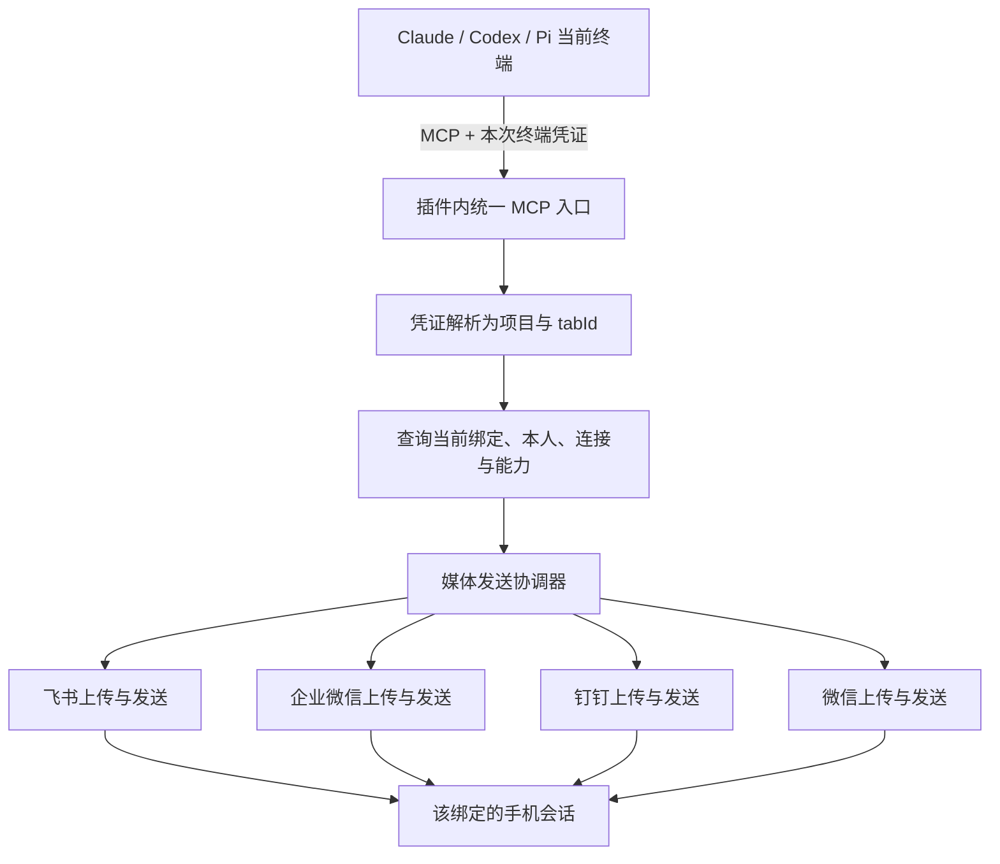

# 手机媒体发送 MCP 设计

日期：2026-11-01
状态：已按用户审查结论进入实施。四工具与四渠道媒体链路已在工作区实现，自动验证与剩余真机验收见 [实施计划](../plans/2026-11-01-mobile-media-mcp.md)；尚未标记整体交付完成。

## 1. 目标与已确认方向

用户在已有 imux 终端里要求“把图片/视频/文件发到手机”时，CLI 智能体通过工具调用，把本地文件发给**该终端当前绑定的通讯机器人及本人**。

采用一套插件提供的本地 MCP 服务，服务多个终端；工具随 CLI 启动接入，手机绑定、解绑、换绑和断线状态在调用时查询。绑定变化不要求重启 CLI，也不要求重新注册工具。

范围包括现有四个渠道：飞书、企业微信、钉钉、普通微信。此前“不列微信”针对渠道对比，媒体能力仍按用户希望四渠道统一接入的方向设计。微信本身的上下文和发送限制不会被 MCP 绕过。

第一版：

- 固定提供 `get_mobile_status`、`send_image`、`send_video`、`send_file` 四个工具；发送流程在插件内部共用。音频（录音、音乐等）走 `send_file` 作为文件附件发送。
- 用户 2026-11-01 审查决定：第一版不暴露 `send_voice`、`send_audio`。第一版不转码，Agent 也很少能拿到 AMR/OPUS 原文件，原生语音基本都会回退为文件；`send_audio` 与 `send_file` 走同一链路，多一个工具只会增加 Agent 选择负担。等某个渠道真正实现并验收原生语音后，再增加 `send_voice`。
- 用户补充要求：媒体发送明确失败时，插件自动回退普通文件发送一次，不再要求 Agent 另调 `send_file`。回退成功须报告实际发送形式；结果不明不能自动回退造成重复发送。
- 支持本地图片、视频、普通文件；音频按普通文件附件发送，第一版不提供原生语音条。
- 用户后续决定：钉钉的 `send_video` 直接按普通文件附件发送，不尝试原生视频，不要求封面与时长，也不读取传入的封面。其它三个渠道保留原生视频路径；四家都仍待真机验收。
- 用户提出发送要求时，由 Agent 决定调用工具；调用结果是发送成败的依据。
- 不另加长系统提示词，不改已有 IDEA MCP 指引；在工具描述中说明使用方式和动态绑定语义。
- 复用现有机器人凭据、连接、绑定、限频与状态机制；不再扫码，不建立第二套机器人连接。
- 沿用 AGENTS：简单转接；断开不补发；未知结果不自动重试；不接管 CLI 调度。

不纳入第一版：自动扫描产物目录、从最终回复里的路径猜测并上传、批量广播、群聊、文本转语音、通用音视频转码、从 URL 下载文件、手机端审批 CLI、消息编辑/撤回、持久发送队列、原生语音条（`send_voice`）、独立的音频附件工具（`send_audio`）。

## 2. 用户可感知的行为

| 场景 | 行为 |
| --- | --- |
| 启动会话，尚未连接手机 | 四个工具已经可用；状态查询返回未绑定；发送明确失败，不选择其它机器人 |
| 运行途中绑定飞书 | 下一次查询或发送立即使用这份绑定；不重启 CLI |
| 用户说“把这张图发到手机” | Agent 传真实本地文件路径；插件上传后发送 |
| 用户只让生成图片，没有提出发送意图 | 不规定必须上传；工具描述不诱导扫描、上传无关文件 |
| 用户明确要求“这次生成后自动发到手机” | 属于本次任务的发送要求，Agent 可在生成后调用 |
| 换绑到企业微信 | 新调用发往企业微信；正在准备或上传的旧调用不得改投新目标 |
| 解绑 | 新调用返回未绑定；旧调用在最终发送前失效 |
| 连接断开、机器人被移除或本人身份失效 | 不等待未来重连后补发；返回具体错误 |
| 平台已接受消息后解绑 | 无法撤回已提交消息；不声称解绑撤销成功 |
| 网络超时，不知道平台是否接受 | 返回结果不明，明确不要自动重发 |
| 发送成功 | 返回平台已接受；不宣称用户已读 |
| 原生媒体过大、格式不支持或发送被明确拒绝 | 自动检查并尝试普通文件发送一次；文件路径也不可用时返回失败，规则见第 7 节 |

Agent 不会因为用户点击绑定按钮就自动获得一条聊天消息。它在需要时调用状态工具，或直接发送；发送服务必须自行复核，不依赖模型记忆。

## 3. 架构



职责边界：

| 层 | 职责 | 不负责 |
| --- | --- | --- |
| CLI 接入 | 注册 MCP、传调用身份 | 手机账号、文件上传 |
| MCP 协议入口 | 握手、列工具、校验参数、返回结果 | 选择收件人、调用 CLI |
| 调用身份注册表 | 凭证映射到存活的终端运行实例 | 把用户输入的 tabId 当身份凭据 |
| 媒体发送协调器 | 动态绑定、文件快照、失效检查、取消与结果归一化 | 平台协议细节、Agent 排队 |
| 渠道适配器 | 能力、上传、最终发送、业务回执 | 查终端、读会话记录、按 Agent 类型分支 |

这是增加主动工具入口，不替换现有“终端最终回复 → 手机”的文本桥接。媒体不写回 CLI 的会话文件，也不从 transcript 里再次识别为待上传附件。

## 4. MCP 服务与 CLI 接入

### 4.1 服务形态

服务名拟为 `imux_mobile`，路径拟为 `/imux/mobile-mcp`，运行在插件所在 IDE/backend 进程。

它与现有 `idea` MCP 是两个独立服务。关闭 IDEA 代码工具的 MCP 注入，不应关闭手机发送工具；复用平台内置 HTTP 不等于依赖 JetBrains MCP 插件是否开启。

优先复用项目已经使用的 `BuiltInServerManager` + `HttpRequestHandler`，增加独立 handler，不修改 Pi 上报协议。现有 `PiReportEndpoint`、`PiSessionReportHandler` 是端口预热、生命周期和线程切换的参考；官方 SDK 示例 `oauth2/AuthRestService.kt` 也使用平台内置服务。

采用 MCP Streamable HTTP。第一版只需要固定工具集合和 JSON 响应，不需要为绑定变化建立 SSE 推送：

- 处理 `initialize`、`notifications/initialized`、`ping`、`tools/list`、`tools/call` 和适用的取消通知。
- 声明 tools 能力，不声明工具列表动态变化、resources、prompts、sampling、异步 tasks 等未实现能力。
- 请求返回 JSON-RPC JSON；接受的通知返回 HTTP 202 空体；GET 不提供 SSE 时返回 405。
- 正确处理协议版本协商、协议版本头、Content-Type、Accept、未知方法及非法参数。
- 不把自定义 REST POST 包装后称为 MCP；以上握手和工具协议须用真实客户端验证。
- 无需使用 `Mcp-Session-Id` 充当业务会话身份；本设计采用无 MCP 会话 ID 的请求处理，业务身份由每请求携带的凭证确定。
- RPC 活动请求以“调用凭证 + JSON-RPC id”区分，不能只按 id 在整个 IDE 中索引。
- 第一版按官方 2025-11-25 文档设计，并验证三种实际 CLI 的协商版本。仅声明实现和测试过的版本；不猜客户端版本兼容。
- 采用范围受控的协议实现，复用 Gson、平台 HTTP 和协程；不因此引入 Spring、额外 Node/Python helper 或完整服务框架。若客户端联调证明所需协议范围超出此边界，再单独评估官方 MCP SDK 及依赖。

平台入口必须检查本地访问、Host、存在时的 Origin 与调用凭证，拒绝非允许来源；不能因为使用 localhost 就省略鉴权。处理不能占用 EDT 或 Netty EventLoop；上传放到 IO 协程，响应异步写回。

### 4.2 启动接线

| CLI | 拟采用方式 | 验证重点 |
| --- | --- | --- |
| Claude | 合并到现有 `--mcp-config` 的 `mcpServers`，与 `idea` 并列；Authorization 值引用专用环境变量 | JSON 与 shell 两层转义、实际展开变量、已有 IDEA 配置不丢失 |
| Codex | 沿用现有启动配置注入，增加 `mcp_servers.imux_mobile`；用 `bearer_token_env_var` 读取专用环境变量 | 工具实际可见且能调用；不能只证明 initialize 成功 |
| Pi | 新增独立 `pi-imux-mobile-mcp.js`，沿用现有 `registerMcpServer` 扩展模式；四个工具优先直接暴露 | 新建、恢复、扩展 reload；环境值消费后保持本次实例状态 |

令牌通过 `IMUX_MOBILE_TOKEN` 等专用环境变量传入，不把令牌实值写进命令行、URL、项目配置或日志。Claude 配置中若用 `${IMUX_MOBILE_TOKEN}`，shell 组装必须保留字面量，不能在启动命令拼装时展开成秘密值。Pi 的缓存不得与现有 IDEA MCP 扩展共用 key。

“只在已绑定时注入”不可采用：用户通常在 CLI 启动后才连接手机。新功能交付后，普通 imux 终端在启动时就接入四个工具，不要求已有机器人；未绑定调用只有查询或拒绝，不建立平台连接。

新增、恢复两条启动路径均覆盖。单次后台 Agent、副驾驶、审查等不因本功能自动获得发送身份；它们若是同一 CLI 的子代理，工具继承与调用权限由 CLI 决定，最终也只归属于父终端。

### 4.3 冷启动与旧进程

端口初始化在后台提前完成，生成命令与环境使用**同一份**启动上下文。不能分别准备两次导致命令 token 与服务端登记不同；不能因为瞬时端口未就绪，就无提示地让该终端永久缺少 MCP。

建议新增中立的终端启动准备步骤：后台等待端点就绪，设置有限超时；随后进入现有创建终端流程。失败不阻止 CLI 启动，但明确显示本次媒体工具未接入，不能显示为可用。

本功能安装前已经运行的 CLI 没有该配置和身份，不保证自动热注入。需要用户正常重开或恢复该会话一次；不得为了接 MCP 自动杀掉正在执行的 CLI。**之后的绑定、换绑、解绑均不再需要重启。**

## 5. 调用身份与生命周期

每次实际启动 CLI 分配一份随机、不透明的调用令牌，服务端保存：

```text
token -> project identity + tabId + terminal run generation + lifecycle
```

- 令牌只标识调用者，不提前绑定机器人，不包含平台密钥。
- 工具参数不接受 `robotId`、`chatId`、`projectPath` 或 `tabId` 来改变发送目的地。
- 同项目开两个终端，必须有不同令牌；不能只靠项目路径区分。
- `/new`、`/clear` 等原生会话 ID 迁移不换运行实例，继续按稳定 tabId 查绑定。
- 拖动、分屏导致编辑器重建不撤销令牌；令牌跟随真实 TerminalView/CLI 生命周期，而非 FileEditor。
- CLI 退出、终端实际关闭、项目关闭、IDE 退出：撤销对应令牌并取消未提交发送。
- 恢复会话启动新 CLI 时生成新令牌；旧令牌不能访问恢复后的会话。
- 未绑定时令牌继续有效，允许状态查询；解绑本身不删除 MCP 身份。

媒体服务用现有 `BindingRegistry.bindingForTab` 查绑定，用已有 owner 取本人目标。不能把“最后一个发消息的人”当收件人。

令牌是终端隔离手段，不宣称它能防御同一系统用户下有完整本机权限的恶意进程。

## 6. 四个工具的合同

### 6.1 `get_mobile_status`

无参数，查询调用者对应的终端；不上传、不发消息、不为探测能力试发平台消息。

建议返回：

```json
{
  "binding": "bound",
  "channel": "feishu",
  "robot_name": "开发助手",
  "connection": "online",
  "send_state": "ready",
  "capabilities": {
    "image": {"native": true, "max_bytes": 10485760},
    "file": {"native": true, "max_bytes": 31457280},
    "video": {"native": true, "formats": ["mp4"]}
  }
}
```

示例是拟定返回结构，数值和 native 能力必须由实施后适配器实际提供；未实现的能力返回 false，未知上限返回 null 并说明，不能用 0 表示无限。平台套餐额度未查询，不编造 remaining。

绑定状态至少区分 unbound/bound；连接至少区分 connecting/online/offline/kicked/failed；发送状态区分 ready/attention/unavailable，保留可读原因。

现有 `SendFailing` 可能表示发送失败，也可能是钉钉接收额度耗尽。不能把它或 `isWorking` 直接当作“允许发送”的布尔值：`isWorking` 同时包含 Connecting 与 SendFailing（`ChannelSpi.kt:41`）。状态工具如实报告已知问题；链路在线但历史业务错误时，允许一次正常调用由平台重新判定，不永久锁死恢复机会。

工具描述：查询当前终端连接的手机渠道及媒体能力；绑定可随时变化，此结果不保证稍后的发送一定成功。

### 6.2 按媒体类型区分发送工具

| 工具 | 首选发送形式 | 明确失败后的处理 |
| --- | --- | --- |
| `send_image` | 图片消息 | 自动尝试普通文件一次 |
| `send_video` | 飞书、企业微信、微信优先视频消息；钉钉直接文件附件 | 原生路径明确失败时尝试文件一次；钉钉已经走文件链路，不重复发送 |
| `send_file` | 普通文件附件，包括音频文件 | 返回结果，不递归回退 |

类型由工具名称确定，不再让 Agent 传 `kind`。文件回退是用户要求的默认行为，不提供由 Agent 关闭的 `allow_file_fallback` 参数。

| 参数 | 类型 | 规则 |
| --- | --- | --- |
| `path` | string，必填 | 本地文件绝对路径；必须存在、可读、为普通文件 |
| `file_name` | string，可选 | 展示文件名；去除路径与控制字符，不用它伪装实际格式 |
| `duration_ms` | integer，可选，仅 `send_video` | 视频时长（毫秒），必须非负；渠道需要而无法取得时不能原生发送，进入文件回退 |
| `thumbnail_path` | string，可选，仅 `send_video` | 视频封面图片绝对路径；需要封面的渠道必须提供，按普通文件同样校验和冻结 |

第一版一次一个文件，不提供收件人参数、不接受 URL、不支持目录或通配符。不加 caption 参数，避免媒体与说明拆成两个请求后引入部分成功语义；Agent 的最终文字回复仍走现有文本桥接。

插件不限制目录：任何可读的本地普通文件都可以发送，不要求先复制进 `.imux/attachments`。理由是收件人固定为本人手机，不存在外发给第三方的风险；路径权限交给 CLI 自身工具审批和用户任务授权。插件只处理显式传入的单个文件，不扫描其它文件。

用文件内容特征及类型检测校验请求的展示形式；只改后缀不能使非图片通过图片检查。调用 `send_file` 直接按普通文件发送，仍服从该渠道文件类型限制。同一张 PNG 调用 `send_image` 优先发图片，调用 `send_file` 则直接发附件。

工具说明拟为：

> 将一个已存在的本地文件发送到当前终端绑定的手机聊天，优先使用本工具对应的消息形式。原生媒体明确失败时，插件会自动尝试普通文件发送一次，返回实际发送形式。不要因为结果里记载原生发送失败就再次调用发送工具；应以最终 outcome 为准。绑定关系以调用时为准；不要猜收件人。成功表示平台接受，不代表已读。返回 unknown 时不要自动重试。没有发送要求时，不扫描或上传其它文件。

上述为共用描述；每个工具补充对应的具体形式。`send_file` 明确说明适用于文档、压缩包、代码以及音频文件，且不再回退。

不往会话追加“绑定已变化”的合成用户消息，不要求先查询才能发送，也不承诺工具暴露后模型一定每次都会调用。

### 6.3 结果

结果同时提供简短文字与结构化字段，避免客户端只展示 `content` 时看不到原因。

```json
{
  "outcome": "accepted",
  "requested_kind": "video",
  "delivered_as": "file",
  "channel": "feishu",
  "file_name": "demo.mov",
  "reason": "当前视频格式不符合原生视频要求，已按文件附件发送",
  "fallback_used": true,
  "primary_error": "unsupported_format",
  "platform_message_id": null,
  "retryable": false
}
```

| outcome | 含义 | 处理 |
| --- | --- | --- |
| accepted | 平台明确接受最终消息 | `isError=false`；返回真实展示形式；平台没返回 ID 就为 null |
| rejected | 能确认本次没有被接受 | `isError=true`；说明 unbound/offline/too_large/unsupported/rate_limited/permission/quota/binding_changed 等原因 |
| unknown | 最终发送可能已提交，但没有可靠回执 | `isError=true`；`retryable=false`；不自动重试、不声称没发出去 |

凭证失效按 HTTP 鉴权失败处理；MCP 非法方法/参数走协议错误；正常工具执行的业务失败用工具错误，三类不能混淆。

## 7. 媒体类型与各渠道实现

本节基于 [四渠道核对](../../channel-comparison.md)；数字来自具体上传接口，不能套用入站附件的 100 MiB。

| 渠道 | 图片 | 普通文件（含音频） | 视频 | 原生语音（第一版不做，仅记录） |
| --- | --- | --- | --- | --- |
| 飞书 | multipart 上传取得 image_key，再发 image；约束 10 MB | 文件上传得到 file_key，再发 file；30 MB | 上传 MP4，再发 media；必要元数据按接口补齐 | 原生 audio 需要符合 OPUS 要求，不能直接把 MP3 标成 OPUS |
| 企业微信 | 复用现有 WS，三步素材上传，再主动发 image；10 MB | 同一素材上传链路，再主动发 file；20 MB | MP4，10 MB，再发 video | AMR 原生 voice 上限 2 MB |
| 钉钉 | 上传媒体，再用 sampleImageMsg；媒体上传页图片 20 MB | sampleFile；20 MB，平台格式限制以回执为准 | 按用户要求直接 `type=file` 上传，再发 `sampleFile`；MP4 保留原名/后缀，不提供原生视频样式 | 上传页与机器人模板页格式存在差异，原生语音仅采用共同明确且验证通过的格式；其它按文件能力判断 |
| 微信 | 取得上传参数、AES-128-ECB 加密、上传 CDN、sendmessage 图片项 | 同样上传，再发文件项 | 官方客户端已有视频项发送路径 | 不因类型中有 voice 字段就声明原生语音可用 |

企业微信素材上传会话、分片大小和素材有效期遵守官方协议；不能把“最多 100 片 × 512 KB”当作普通文件可发 50 MB。飞书发送大小检查区分媒体本体与 JSON；钉钉下载已有消息附件用的 accessToken 逻辑不直接等同于旧版媒体上传 token 规则，实施时核对所选上传接口。

微信媒体发送沿用现有文本发送的两条约束：

- 发送依赖入站消息带来的 `context_token`（`WeixinConnection.kt` 按用户只在内存记最新值）。CLI 长时间运行后主动发媒体，可能因会话过期被拒；被拒时复用现有提示“请在微信给机器人发任意一条消息后再试”，不本地预先拦截。缺失或过期时的处理与文本发送一致。
- 微信设计记录的“用户每发一条消息，机器人最多推 10 条”是经验值，媒体消息、回退后的文件消息和最终文字回复共用这份额度。能力说明注明这一点；代码仍不计数、不拦截，以服务端返回为准。

### 视频与转码的交付边界

本版不自动安装或捆绑 ffmpeg，也不由插件启动 AI 生成封面。

当前四渠道视频交付条件已分别核对：

| 渠道 | 封面 | 时长 | 当前交付形式 |
| --- | --- | --- | --- |
| 飞书 | `image_key` 可选 | 上传文件的 `duration` 可选 | 满足 MP4、大小及权限要求时尝试原生视频 |
| 企业微信 | 视频消息接口没有必填封面字段 | 没有必填时长字段 | 用上传后的 `media_id` 发 video；title、description 也可选 |
| 微信 | 官方客户端 `sendVideoMessageWeixin` 不传封面，上传使用 `no_need_thumb=true` | 该发送路径不传时长 | 视频项含媒体引用与密文大小；这说明客户端行为，不代表完整服务端契约 |
| 钉钉 | 当前路径不需要 | 当前路径不需要 | 始终以普通文件附件交付，不尝试要求封面和时长的 `sampleVideo` |

钉钉能力查询返回 `supported=true`、`native=false`、`delivery_as=file`、空 `required_fields`。成功结果为 `requested_kind=video`、`delivered_as=file`，并说明“已作为文件发送”。这是固定交付策略，不是先失败再回退，因此 `fallback_used=false`、`primary_error=null`。

官方普通文件清单未保证接收 MP4。本地为用户明确要求的视频文件开放 MP4 尝试，上传和 `sampleFile` 仍可能被平台拒绝；拒绝时如实报错，不能宣称“自动按文件发送”就一定成功，也不改后缀或重复发文件。

原生视频需要的时长/封面通过第 6 节的 `duration_ms` 与 `thumbnail_path` 参数提供；Agent 可以利用视频生成步骤已经取得的元数据和封面，不需要插件另启动媒体处理进程。没有可靠来源时不能编造时长。第一版插件不内置通用视频探测器。

原生视频路径如果缺少渠道必需的元数据，或格式不符合要求，自动进入文件回退；只有在该渠道文件能力允许尝试时才实际提交附件，最终仍以平台回执为准。钉钉视频已直接走文件路径，文件请求失败后不再执行一次“文件回退”。MP3 等其它格式没有因此一并放宽。

原生视频路径校验提供的时长和图片封面，适配器负责单位换算；能力查询返回该渠道需要的字段。钉钉直接文件交付时不读取视频封面、不消费时长。对外说明须区分代码支持与真机验收；钉钉的原生视频能力明确为 false。

### 自动回退文件的规则

回退由媒体发送协调器执行，属于同一次工具调用，不等待用户再次确认或 Agent 再发起调用。

1. 原生类型不支持、格式/媒体大小不符合、缺少视频封面或时长、媒体上传失败且尚未提交最终消息，或平台明确拒绝原生消息时，进入一次文件回退。
2. 回退前重新校验原绑定、epoch、调用凭证、连接和普通文件能力/大小/格式；使用同一份原文件快照，不修改后缀、不偷换文件内容、不转投新绑定。
3. 没有绑定、已解绑/换绑、离线、取消、鉴权失效、文件不存在/不可读/仍在变化，以及已确认对文件发送也适用的额度或权限问题，不再发出一个已知不能成立的文件请求；说明为何回退不可执行。只限制原生类型的权限错误仍可尝试文件。
4. 最终消息已提交但超时、连接中断或业务结果不足以证明拒绝，返回 unknown，不自动回退。原生消息明确成功则结束，不再发文件。
5. 普通文件回退最多一次。`send_file` 本身就是文件链路，失败后不重复调用同一路径。
   钉钉 `send_video` 同样直接使用文件链路，失败后不再回退或重发。
6. 回退遵守同一个总时限、取消状态和发送限频；文件类资源标识与原生媒体标识不能通用时重新上传，不直接复用错误类型的 media_id。
7. 回退成功的最终结果为 accepted，`delivered_as=file`、`fallback_used=true`，附原生失败原因；不能因原生失败仍把整体标成失败。回退明确失败则返回两阶段原因；回退最终发送结果未知则整体 unknown。

手机/CLI 的确认用语应是“图片消息发送失败，已作为文件附件发送”等符合真实结果的描述，不声称“图片消息已发送”或“视频消息已发送”。

## 8. 文件准备、发送和换绑

完整流程：

1. 校验令牌对应的终端运行实例仍存活。
2. 查当前绑定，取得 robotId、epoch、本人目标和当前连接对象；没有绑定立即结束。
3. 查实际渠道能力和已知限制，校验路径、文件类型、大小及所需元数据。
4. 以流式方式复制到插件专用临时文件，冻结本次发送内容；复制时执行字节上限，防止源文件增长导致绕过。不把大文件整体读进内存。复制前后核对文件身份、大小与修改时间，发现仍在写入则返回 file_changed；这不是对任意并发写入的文件系统级事务保证，调用说明要求产物写完后再发送。
5. 再次检查绑定与运行实例；每次发送独立执行，不按调用顺序排队，也不因其它发送正在执行而返回 busy。CLI 退出、令牌撤销或 IDE 关闭时，活动请求取消，不补发。仅在状态检查、提交标记和结果完成时使用短同步边界，不持锁执行网络 IO。
6. 渠道上传临时快照，取得平台资源标识。上传前后均检查取消和绑定失效。
7. **最终发送前重新检查原绑定的 robotId、epoch、本人目标、连接实例和在线状态。**
8. 向原绑定提交消息，读取回执；原生路径明确失败时按第 7 节自动进入一次文件回退，每次实际提交都重新执行身份与绑定检查；最终归一化 accepted/rejected/unknown。
9. finally 清理本地快照、封面副本、加密临时文件；不删除用户原文件。

要避免“检查完立刻换绑”的竞态，绑定更新与最终发送提交标记应使用同一个短同步边界：在锁内确认绑定并登记本次请求进入最终发送阶段，不在锁里执行网络 IO。解绑先于该边界则阻止发送；后于该边界则尽力取消，但消息可能已经发往原目标。

取消和总超时也必须参与这个原子边界：先拿协调器锁，在锁内检查结果是否仍可完成，再进入 `route.commit` 的绑定锁并写入 `submitted`；超时、取消、失效以及发送协程完成结果都在协调器锁内判定并完成。固定锁序为“协调器锁 → 绑定锁”，不得反向嵌套。中断先完成结果时禁止后续提交；提交先进入该边界而尚无可靠回执时，中断返回 unknown，不能回 rejected/cancelled 或 rejected/timeout。

这个边界不意味着能在本地撤销平台请求；网络写入开始后，取消或超时不能保证对端没有收到。不能为追求这一保证锁住 UI 等网络，也不能把请求改投新目标。

绑定变更订阅复用现有 `BridgeHub.revision`/绑定变更入口，收到变化后取消对应失效请求；最终发送复核仍然必需。同一机器人断线重连换了连接实例，也不把旧请求挂到新连接补发。

普通未知错误不自动重发；原生明确失败后的文件回退按第 7 节执行。明确 token 无效时，可按已有渠道策略刷新一次；只有确认原发送被拒绝才可重新提交，未知回执不能借刷新凭据重复发送。企业微信素材分片的官方幂等重传不等于最终消息可无限重试。

不增加“保证不丢”的发送箱、跨重启恢复或文件哈希去重。相同文件合法发送两次不能被吞；正在处理的同一 RPC ID 则不应并行执行两份。

## 9. 限频、状态与超时

- 媒体最终消息与普通文本共用该机器人的既有限频器，不能为 MCP 单开一套额度绕过限制。
- 上传接口有独立频率规则时单独限制上传；一个文件的上传请求数与最终消息条数分开计算。
- 不把所有渠道一律限制成最小的 10 MB；按“当前渠道 + 实际发送形式”校验。
- 微信没有已确认服务端统一大小上限，第一版可采用 100 MiB 本地文件保护值，能力返回须注明是本地值；不伪称官方限制。
- 上传/发送状态不把现有 Connecting 当 Online；历史 SendFailing 不是永久禁止正常尝试的开关。
- 单次调用建议设总时限 120 秒（含文件准备、上传、渠道限频等待、发送与回退），这是建议本地保护值。客户端工具超时必须大于该时限，并在启动注入时显式设置，不依赖默认值：Codex 的 MCP 工具默认超时短于 120 秒，注入时同时设置 `mcp_servers.imux_mobile.tool_timeout_sec`（例如 180）；Claude、Pi 在实施时确认对应的超时配置项并同样显式设置。只作用于 `imux_mobile`，不影响其它 MCP 工具。
- 钉钉每次文件回退会多产生上传与发送调用，计入组织的 API 月额度；个人使用影响不大，能力说明中注明。
- 支持 MCP 显式取消；客户端 HTTP 连接断开本身不等于请求取消，也不因此重新发送。
- 服务端请求超时若发生在最终发送前，可确认未发送；发生在最终发送阶段则保守返回 unknown。
- 不把“已上传资源”当“已发送消息”。只上传成功但没发出的平台临时素材按平台过期规则处理，不为了清理添加无依据的删除调用。

MCP 返回工具结果后，CLI 的“已发送”文字仍可由原有最终回复桥接发到手机；插件不再额外发送一条同内容通知。用户要求同时交付多个文件时，由 Agent 分次调用，保留各文件独立结果。

## 10. 与现有架构的结合

现有 `BridgeIsolationSourceTest` 禁止 bridge 外引用 bridge。不能在 `TerminalHost` 里直接调用 `RobotManager` 或新增 bridge 服务。

沿用 `SessionDecorator` 的中立扩展模式，新建一个**只负责终端启动附加能力**的接口，例如 `TerminalLaunchContributor`：

- 输入：project、tabId、AgentType、本次终端运行标识。
- 输出：结构化 MCP server 配置、环境变量、Pi 扩展，以及需要释放的运行期资源。
- 在创建命令和环境前只准备一次，保存结果供两处共同使用。
- 提供后台准备阶段与终端真正关闭的释放阶段；扩展失败按能力降级，不影响 CLI。
- 桥接包实现 contributor 并在 plugin.xml 注册；terminal 包只认识接口和通用配置类型。
- provider 不返回任意 shell 字符串；终端层继续用既有各平台转义和结构化 JSON/TOML 生成方式。
- 不顺便重构全部 IDEA MCP 接线，只把两个 MCP 配置合并时必需的部分结构化。

拟改动范围：

| 位置 | 变更 |
| --- | --- |
| `terminal/TerminalLaunchContributions.kt`（新） | 中立启动扩展合同、统一准备/释放 |
| `TerminalHost.kt`、`AgentCommand.kt` | 启动附加配置、真实终端生命周期；无 bridge import |
| `bridge/mcp/`（新） | 本地 MCP handler、协议模型、四个工具、令牌注册表、启动 contributor |
| `bridge/media/`（新） | 媒体发送协调器、临时文件快照、统一能力和结果 |
| `bridge/core/` | 新增与平台无关的媒体能力/上传结果/最终发送端口；保留现有文本接口行为 |
| `bridge/channel/<渠道>/` | 分别实现上传与发送，不跨渠道引用实现 |
| `Transports.kt` | 增加 multipart/二进制上传端口，复用项目 HTTP 与代理方式 |
| `BridgeHub.kt`、`RobotManager.kt` | 暴露受控的绑定/owner/连接快照与发送入口，不公开可变连接表 |
| `src/main/js/pi-imux-mobile-mcp.js`（新） | 注册这四个工具的 MCP server |
| `plugin.xml`、语言资源 | handler、启动扩展注册；未接入/发送失败等必要文案 |

UI 继续使用现有连接手机、解绑、换绑入口。无需为每个机器人增加一个 MCP 配置页，也不要求用户填 API Key、端口或收件人。必要错误使用现有 IDE 通知模式，不新增每次发送的插件确认弹窗；CLI 自己的工具审批设置仍有效。

## 11. 验证与交付顺序

### 自动化验证

只用 JUnit 4，中文反引号方法名，断言范围与名字一致；源文件结构检查复用 SourceCode 并登记 Gradle inputs。

| 领域 | 独立验收内容 |
| --- | --- |
| MCP 协议 | initialize、工具列表、工具调用、通知 202、GET 405、非法参数、版本协商、取消 |
| 调用身份 | 缺失/错误/失效 token；同项目两会话不能串目标；项目关闭撤销 |
| 动态绑定 | 启动未绑定→后绑定；解绑；换绑；同机器人解绑再绑 epoch 不同 |
| 生命周期 | `/new` 沿用；分屏/拖动不撤销；CLI 退出撤销；恢复新 token、旧 token 失效 |
| 竞态 | 文件准备、上传、最终发送边界前分别换绑；不改投新目标；已提交不能假称撤回 |
| 文件 | 不存在、目录、不可读、格式与后缀不符、源文件增长、临时文件清理；原文件不被删除 |
| 渠道 | 每渠道各自验证上传请求与最终发送；同一返回值不能代替“实际走了哪条接口”的断言 |
| 限制 | 图片/文件各自边界、JSON 与文件大小分开、共享发送限频、钉钉类型交集 |
| 结果 | 平台拒绝、只有上传成功、最终发送超时 unknown、accepted 不等于已读 |
| 文件回退 | 原生不支持、格式错误、缺封面、上传失败、明确拒绝分别回退；最终结果不明不回退；文件成功只报整体成功；文件失败保留两阶段原因；普通文件不递归重发 |
| 回退边界 | 原生失败后换绑不发文件；文件超限或禁用格式不伪装发送；共享额度失效不重复请求；仅原生权限受限仍尝试文件；回退使用相同快照和剩余总时限 |
| 启动配置 | Claude/Codex/Pi 新建与恢复；各 shell 转义；token 不进入明文命令行；现有 IDEA MCP 保留 |
| 并发 | 发送独立执行，不保证顺序；取消或超时不影响其它调用；提交前中断 rejected，提交后结果不明 unknown；CLI 退出取消活动请求；同 RPC 活动 ID 不重复执行 |

### 真机验收

三个 CLI 分别验证工具**可见、可调用、能取得正确绑定**，不能只测握手。

四个渠道分别验证真实图片、文件、视频，以及通过 `send_file` 发送的音频文件；原生视频核对封面、时长、可播放性。验证绑定后发送、解绑拒发、换绑不串、断线不补、大小边界与平台回执。

视频单列验收：

- 钉钉：只提供 MP4 路径，不给封面、时长，确认上传类型为 file、消息模板为 sampleFile、手机收到文件附件；确认原文件名和内容未变。平台若拒绝 MP4，记录实际错误，不将验收判为成功。
- 钉钉：额外传入不存在的封面路径也不应读取它；检查能力报告原生视频 false，结果说明 file；文件被拒绝时只有一次文件尝试。
- 飞书：不提供封面和时长时验证原生视频；另验可选封面正常显示。
- 企业微信：不提供封面和时长时验证原生视频，遵守视频上传大小限制。
- 微信：不提供封面和时长时验证官方客户端对应的原生视频路径，另验 context_token 过期提示。

改平台启动/API 后运行有效的 IDE build、所有修改文件 lint、匹配 IDE 测试配置或项目测试命令，以及 `./gradlew verifyPlugin` 对本地所有目标 IDE 验证。

建议实施顺序：

1. 中立启动扩展、身份与四个工具，先用假渠道验证动态绑定、自动文件回退和竞态。
2. 飞书、企业微信的图片/普通文件闭环，验证共享限频和真实回执。
3. 钉钉、微信媒体链路，以及各渠道视频。
4. 三 CLI × 四渠道真机验收，平台兼容性验证，更新能力表与使用说明。

阶段可以逐步实现，但四渠道全部达到约定能力前，不称为“整体完成”。

## 12. 本轮审查要点

本稿给出的默认选择：

1. 一个插件内 MCP，四个固定工具，按图片、视频、普通文件区分，音频走普通文件（用户已确认）；普通终端启动时接入，绑定时不重启。
2. 不追加长系统提示词，只用工具描述；不默认上传所有生成文件。
3. 工具没有收件人参数，以调用终端的实时绑定为准。
4. 用户已要求：原生媒体明确失败后自动回退文件一次，由插件完成，无需 Agent 另调；报告实际形式。未知结果不回退，普通文件也不支持时如实失败。
5. 音频通过 `send_file` 作为附件发送；原生语音条、TTS、通用转码不纳入第一版。
6. 视频需要的元数据可以显式提供，不为此强制安装 ffmpeg。
7. 没绑定、断线或换绑就明确结束；不建立补发队列。
8. 安装功能前的旧 CLI 需要正常重开/恢复一次；不强行中断。

以上是待审查的产品与实现方案，不代表新增能力已经实现。

## 13. 依据

项目实现：

- `terminal/AgentCommand.kt`：现有 Claude/Codex 配置注入与环境生成。
- `terminal/TerminalHost.kt`：tabId 创建、TerminalView 生命周期、新建/恢复路径。
- `terminal/SessionDecorations.kt`：已有中立扩展模式。
- `session/PiReportEndpoint.kt`、`PiSessionReportHandler.kt`：内置 HTTP、后台预热和请求处理。
- `bridge/core/BindingRegistry.kt`：tabId、robotId、epoch 和恢复迁移。
- `bridge/BridgeHub.kt`、`RobotManager.kt`、`channel/ChannelSpi.kt`：连接、owner、状态与变更通知。
- `src/main/js/pi-imux-idea-mcp.js`：已有 Pi MCP 注册方式。
- `docs/pi/repo/coding-agent/docs/mcp.md`、`extensions.md`：Pi 官方本地资料。
- `docs/claude-code/en/mcp.md`、`docs/codex/pages/docs/extend/mcp.md`：本地官方资料，实施前结合实际安装版本复核。
- 另一个工程的 `src/mcp/tools/sendMedia.ts`、`src/media/sendClient.ts`、`src/media/behavior.ts`：参考“工具入口与发送服务分开”；不照搬“用户始终在微信”的提示词或全局 activeUser 路由。
- [渠道能力与官方来源对照](../../channel-comparison.md)。

本轮读取的 MCP 官方资料：

```text
https://modelcontextprotocol.io/specification/2025-11-25/basic/transports.md
https://modelcontextprotocol.io/specification/2025-11-25/server/tools.md
```

本稿最初仅为设计；后续实施记录见计划。实现未新增运行时依赖，没有进行真实手机消息发送；新增平台 API 的编译和 verifier 结果与未执行的 IDE lint、真机矩阵分开记录。
